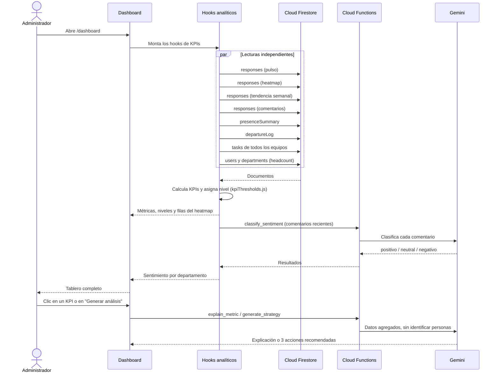
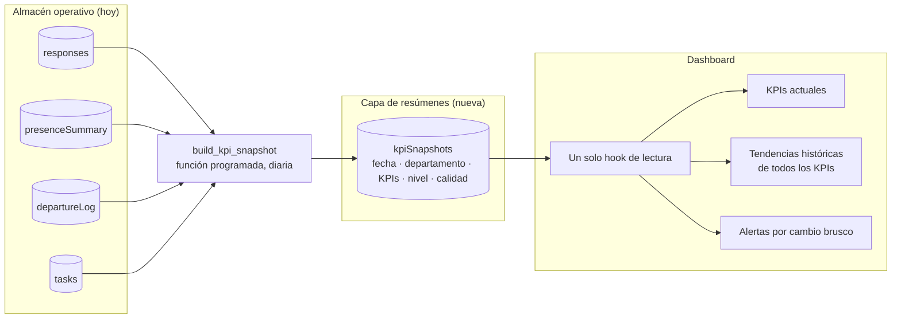

# Arquitectura Analítica — Dashboard Ejecutivo de Salud Organizacional

**Autora:** Melissa Alejandra Chávez
**Programa:** TSU en Desarrollo de Software Multiplataforma — UTSLRC
**Versión:** 1.0 · Octubre 2026
**Objetivo específico que atiende:** *Diseñar la arquitectura analítica.*

Este documento describe cómo viajan los datos desde que se capturan hasta que se convierten en un indicador en el dashboard: qué fuentes hay, cómo se transforman, dónde se guardan, qué capa calcula cada KPI y cómo se controla su calidad. Las secciones 1 a 9 describen lo que **está implementado**. La sección 10 es una **propuesta de evolución** y se marca como tal.

Documentos relacionados: `Fichas_KPIs_Dashboard_Salud_Organizacional.md` (definición de cada KPI), `PRD_Dashboard_Salud_Organizacional.md` y `MVP_Dashboard_Salud_Organizacional.md`.

---

## 1. Principios de diseño

1. **Una fuente por indicador.** Cada KPI sale de una colección concreta de Firestore; no se mezclan orígenes dentro de una misma fórmula.
2. **Umbrales y reglas fuera de la interfaz.** Los niveles de riesgo están en `src/data/kpiThresholds.js` y las reglas de calidad en `src/data/dataQualityRules.js`. Las tarjetas solo los leen.
3. **Funciones puras para calcular.** Las fórmulas (`metricUtils.js`, `dataQualityRules.js`) reciben datos y devuelven resultados sin tocar Firestore, lo que permite probarlas por separado.
4. **Anonimato en la encuesta, transparencia en la presencia.** Las respuestas no guardan quién las envió; la presencia digital sí es por persona, pero el colaborador puede ver su propio historial y el dashboard solo muestra agregados.
5. **La calidad es parte de la arquitectura.** El módulo `/admin/calidad` evalúa los datos antes de confiar en los KPIs y distingue respuestas reales de simuladas.
6. **La IA es un complemento.** Gemini interpreta y resume datos ya agregados; si falla, los KPIs se siguen mostrando.

## 2. Vista general

*Figura 1. Arquitectura analítica por capas. La flecha roja punteada es el cierre del ciclo diagnóstico-acción. Si tu visor no muestra SVG, usa `img/arquitectura_capas.png`.*

*Lectura de la figura:* de arriba hacia abajo se pasa de la captura al indicador. La flecha roja cierra el ciclo diagnóstico-acción: una recomendación de la IA se convierte en tarea Kanban y esas tareas alimentan, a su vez, el KPI de desempeño operativo. Qué hook usa cada colección se detalla en la sección 5.

## 3. Capas

| Capa | Qué hace | Dónde está en el repositorio |
|---|---|---|
| 1. Fuentes | Captura eventos del negocio: respuestas, actividad, bajas y tareas. | `src/pages/SurveyRunner.jsx`, `src/pages/WellnessSurvey.jsx`, `src/components/TeamKanban.jsx`, `src/pages/admin/UserManagement.jsx` |
| 2. Ingesta y transformación | Valida y convierte los eventos al esquema de análisis; resume la presencia por día. | `src/services/surveyService.js`, `src/services/activityService.js`, `src/services/taskService.js`, `functions/main.py` |
| 3. Almacén | Guarda los datos en colecciones de Cloud Firestore con reglas de acceso por rol. | `firestore.rules`, `firestore.indexes.json` |
| 4. Capa analítica | Calcula KPIs, asigna niveles y evalúa la calidad. | `src/hooks/`, `src/utils/metricUtils.js`, `src/data/kpiThresholds.js`, `src/data/dataQualityRules.js` |
| 5. IA | Clasifica sentimiento, explica métricas y propone acciones, solo con datos agregados. | `functions/main.py`, `src/services/aiService.js` |
| 6. Presentación | Muestra tableros, alertas, calidad y reportes; permite actuar sobre los hallazgos. | `src/pages/Dashboard.jsx`, `src/pages/DataQuality.jsx`, `src/components/`, `src/services/exportService.js` |
| Transversal: seguridad | Autenticación, roles y rutas protegidas. | `useAuth.jsx`, `ProtectedRoute.jsx`, `firestore.rules`, claim `role` en Firebase Auth |

## 4. Modelo de datos analítico

| Colección | Qué guarda | Quién escribe | Qué KPI alimenta |
|---|---|---|---|
| `responses` | Una respuesta anónima por encuesta: `enps`, `workLifeBalance`, `psychosocialFactors`, `openText`, `departmentId`, `weekId`, `source` | `submitSurveyResponse` (cliente) o `scripts/seed.js` (simuladas) | eNPS, presión laboral, participación, seguridad psicológica, heatmap, sentimiento, calidad |
| `surveyCompletions` | Control de quién ya contestó cada ciclo, sin vincularlo a su respuesta | Cliente, al terminar la encuesta | Encuestas pendientes (no entra a los KPIs) |
| `activityLogs` | Eventos de actividad por persona: `userId`, `type`, `timestamp` | `logActivity` (cliente) | Materia prima del ausentismo |
| `presenceSummary` | Un documento por persona y día laboral: `present`, `workDay`, `departmentId` | `compute_daily_presence` (programada) | Ausentismo digital |
| `departureLog` | Una baja: `departmentId`, `reason`, `recordedAt` | Cloud Functions de usuarios | Rotación |
| `teams/{id}/tasks` | Tarjetas Kanban: estado, fecha límite, `completedAt`, origen | Cliente y Cloud Functions | Desempeño operativo |
| `users` | Perfil, rol, departamento, horario de trabajo, estado activo | Cloud Functions de usuarios | Headcount (denominador de participación y rotación) y horario del ausentismo |
| `departments` | Catálogo de áreas | Administración | Agrupación de todos los KPIs por departamento |
| `surveyTemplates` | Plantillas de encuesta y su mapeo a indicadores (`mapsTo`) | Constructor de encuestas | Define qué campos llegan a `responses` |

## 5. Linaje de los KPIs

Cada fila responde a la pregunta *¿de dónde sale este número?*

| KPI | Hook | Colección fuente | Regla de cálculo | Nivel |
|---|---|---|---|---|
| eNPS, presión laboral, participación, seguridad | `useOrgHealthMetrics` | `responses` + headcount de `users` | `metricUtils.js` y fórmula de eNPS | `kpiThresholds.js` |
| Riesgo psicosocial por departamento | `useDepartmentRisk` | `responses` + `departments` | Promedio por factor; autonomía y seguridad invertidas | Cortes de riesgo 2, 3 y 4 |
| Tendencia semanal | `useWeeklyTrends` | `responses` | Misma fórmula, agrupada por `weekId` | — |
| Ausentismo digital | `useAbsenceMetrics` | `presenceSummary` | Días sin actividad / días laborales esperados | `digitalAbsence` |
| Rotación | `useTurnoverMetrics` | `departureLog` + headcount | Bajas / (activos + bajas) | `turnover90d` |
| Desempeño operativo | `useTeamPerformance` | `tasks` (todos los equipos) | Tareas al corriente, cumplimiento y puntualidad | `taskOnTrack`, `taskCompletion` |
| Sentimiento | `useWeeklySentiment` | `responses.openText` | Clasificación con Gemini y balance neto por departamento | — |
| Calidad de datos | `useDataQuality` | `responses` + cobertura de presencia y bajas | Puntaje ponderado de 5 chequeos | `QUALITY_LEVEL_FROM` |

## 6. Flujos de datos

### 6.1 Captura (en el momento del evento)

1. La persona contesta una encuesta. `submitSurveyResponse` lee la plantilla, mapea cada pregunta a un campo del esquema (`mapsTo`), normaliza las escalas y guarda la respuesta **sin identificar a quien la envió**. Aparte se registra en `surveyCompletions` que esa persona ya contestó.
2. Cada inicio de sesión, envío de encuesta o acción en el Kanban genera un evento en `activityLogs`. La navegación se registra como máximo una vez cada 5 minutos para no saturar la base.
3. Cuando la administración desactiva o elimina una cuenta, la Cloud Function correspondiente escribe la baja en `departureLog`.

### 6.2 Proceso programado (cada noche)

`compute_daily_presence` corre a las 23:30 (America/Hermosillo). Para cada usuario activo cuyo horario incluya el día de hoy, busca si hubo al menos un evento en `activityLogs` dentro de su ventana de trabajo y escribe `presenceSummary/{usuario}_{fecha}` con `present: true/false`. Así el ausentismo se calcula sobre un resumen diario y no sobre miles de eventos sueltos.

### 6.3 Consulta (cuando se abre el dashboard)

Los cálculos se hacen en el navegador porque el proyecto no tiene un servidor propio: Firestore y las Cloud Functions son el único backend. Esa decisión simplifica el despliegue, pero tiene un costo que se discute en la sección 9.

## 7. La calidad de datos como compuerta

El módulo `/admin/calidad` es el control de calidad de la arquitectura:

- **Qué evalúa:** completitud, rangos válidos, muestra mínima por departamento, posibles duplicados y frescura de las respuestas, con un puntaje ponderado (90 o más es confiable; menos de 50 no debe usarse para decidir).
- **Qué distingue:** respuestas reales (`source: "live"`) frente a simuladas (`synthetic_seed`), con filtro por origen.
- **Qué informa de las demás fuentes:** si hay registros de presencia en los últimos 30 días y headcount suficiente para calcular rotación.
- **Qué no hace:** no modifica ni elimina datos; explica cada hallazgo y cómo corregirlo.

Además, cada tarjeta de KPI aplica una **muestra mínima** (`MIN_SAMPLE`) y muestra "Sin datos" en lugar de un valor poco confiable.

## 8. Seguridad y privacidad en la arquitectura

- **Roles con claims:** el rol (`admin`, `employee`, `team_lead`) viaja en el token de Firebase Auth y lo usan tanto las reglas de Firestore como las Cloud Functions.
- **Rutas protegidas:** `ProtectedRoute` limita cada pantalla a sus roles; el dashboard y la calidad de datos son solo para administración.
- **Operaciones sensibles en el servidor:** alta de usuarios, contraseñas temporales, bajas y equipos pasan por Cloud Functions con el Admin SDK, no por escrituras directas del navegador.
- **Secretos fuera del código:** la clave de Gemini es un secreto de Cloud Functions, no se incluye en el cliente.
- **Privacidad por diseño:** las respuestas de encuesta no guardan identidad, la IA recibe solo agregados y comentarios sin autor, y el detalle de eventos de actividad (`activityLogs`) solo lo lee la propia persona; la administración trabaja con el resumen diario y el dashboard muestra solo agregados.

## 9. Decisiones de diseño y compromisos

| Decisión | Por qué | Compromiso |
|---|---|---|
| Firebase como único backend | Sin servidores que mantener; despliegue simple para un prototipo | La lógica de negocio está repartida entre navegador y Cloud Functions |
| KPIs calculados en el navegador | Código sencillo y resultados al instante | En la versión revisada, cada carga del dashboard vuelve a leer colecciones completas (sobre todo `responses`, que se lee varias veces); el costo y el tiempo crecen con los datos |
| Ausentismo por actividad en el sitio | El prototipo es de trabajo remoto; en un entorno presencial se usaría un checador con huella o reconocimiento facial | Mide presencia digital, no asistencia física; no distingue vacaciones ni permisos |
| Resumen diario de presencia | Evita recorrer todos los eventos en cada consulta | Hay un desfase de hasta un día |
| Umbrales propuestos, no oficiales | No existe un estándar único aplicable a la organización | Deben calibrarse con datos reales |
| IA solo sobre datos agregados | Protege la privacidad y reduce el costo | Las recomendaciones dependen de la calidad del agregado |

## 10. Evolución propuesta *(no implementada)*

**Problema que resuelve:** hoy el dashboard recalcula todo en cada visita y solo tiene historia para las métricas de encuesta; ausentismo, rotación y desempeño no tienen tendencia.

**Propuesta:** agregar una capa de resúmenes. Una Cloud Function programada calcula los KPIs una vez al día y guarda una fotografía por fecha y departamento; el dashboard lee esa fotografía en lugar de recalcular.

| Beneficio | Cómo se logra |
|---|---|
| Menos lecturas y carga más rápida | El dashboard lee decenas de documentos de resumen en lugar de colecciones completas |
| Tendencias de ausentismo, rotación y desempeño | Cada fotografía diaria conserva el valor de ese día |
| Alertas por cambio brusco (eNPS −10, presión +10) | Se comparan dos fotografías consecutivas |
| Una sola definición de cada fórmula | La función programada es el único lugar donde se calcula |
| Rastro de la calidad en el tiempo | El puntaje de calidad se guarda junto a cada fotografía |

**Paso intermedio sin función programada:** compartir una sola lectura de `responses` entre todos los hooks (por ejemplo con un contexto de React) elimina las lecturas repetidas sin cambiar la arquitectura.

**Pendiente asociado:** pasar los cálculos de `metricUtils.js` y `dataQualityRules.js` a pruebas automáticas antes de moverlos a la función programada, para comprobar que el resultado no cambia.
