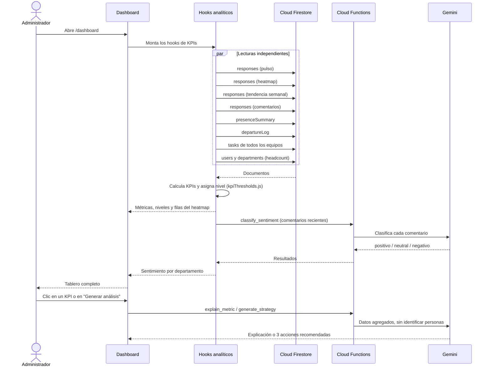
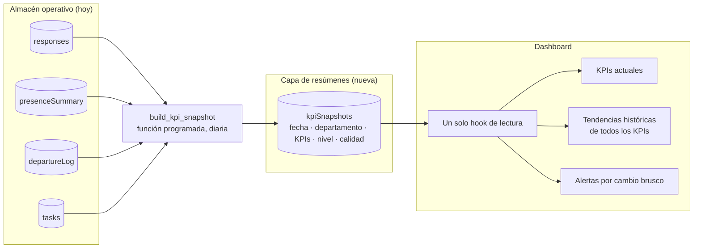

# Arquitectura Analítica — Dashboard Ejecutivo de Salud Organizacional

**Autora:** Melissa Alejandra Chávez
**Programa:** TSU en Desarrollo de Software Multiplataforma — UTSLRC
**Versión:** 1.0 · Octubre 2026
**Objetivo específico que atiende:** *Diseñar la arquitectura analítica.*

Este documento describe cómo viajan los datos desde que se capturan hasta que se convierten en un indicador en el dashboard: qué fuentes hay, cómo se transforman, dónde se guardan, qué capa calcula cada KPI y cómo se controla su calidad. Las secciones 1 a 9 describen lo que **está implementado**. La sección 10 es una **propuesta de evolución** y se marca como tal.

Documentos relacionados: `Fichas_KPIs_Dashboard_Salud_Organizacional.md` (definición de cada KPI), `PRD_Dashboard_Salud_Organizacional.md` y `MVP_Dashboard_Salud_Organizacional.md`.

---

## 1. Principios de diseño

1. **Una fuente por indicador.** Cada KPI sale de una colección concreta de Firestore; el proxy de actividad digital combina los eventos diarios con permisos aprobados, sin inferir asistencia física.
2. **Umbrales y reglas fuera de la interfaz.** Los niveles de riesgo están en `src/data/kpiThresholds.js` y las reglas de calidad en `src/data/dataQualityRules.js`. Las tarjetas solo los leen.
3. **Funciones puras para calcular.** Las fórmulas (`metricUtils.js`, `dataQualityRules.js`) reciben datos y devuelven resultados sin tocar Firestore, lo que permite probarlas por separado.
4. **Desidentificación de respuestas.** Todas las encuestas requieren sesión. La Cloud Function aplica unicidad por persona/ciclo, pero omite el UID de `responses`; el control de completado queda separado, sin hora de respuesta y solo es legible por su propietario. Las reglas bloquean lectura de respuestas para colaboradores y escritura directa desde cliente. El texto libre puede incluir información identificable, por lo que se recomienda no escribir nombres ni datos personales.
5. **La calidad es parte de la arquitectura.** El módulo `/admin/calidad` evalúa respuestas recientes antes de confiar en los KPIs. No hay datos sintéticos ni controles de origen en la aplicación.
6. **La IA es un complemento.** Gemini interpreta y resume datos ya agregados; si falla, los KPIs se siguen mostrando.

## 2. Vista general

*Figura 1. Arquitectura analítica por capas. La flecha roja punteada es el cierre del ciclo diagnóstico-acción. Si tu visor no muestra SVG, usa `img/arquitectura_capas.png`.*

*Lectura de la figura:* de arriba hacia abajo se pasa de la captura al indicador. La flecha roja cierra el ciclo diagnóstico-acción: una recomendación de la IA se convierte en tarea Kanban y esas tareas alimentan, a su vez, el KPI de desempeño operativo. Qué hook usa cada colección se detalla en la sección 5.

## 3. Capas

| Capa | Qué hace | Dónde está en el repositorio |
|---|---|---|
| 1. Fuentes | Captura respuestas, actividad, permisos, perfiles públicos y tareas. | `src/pages/SurveyRunner.jsx`, `src/pages/MiEspacio.jsx`, `src/components/TeamKanban.jsx`, `src/pages/admin/UserManagement.jsx` |
| 2. Ingesta y transformación | Valida solicitudes en el navegador y en Cloud Functions, asigna datos laborales, resume presencia digital y sube fotos con acceso controlado. | `src/services/leaveService.js`, `src/services/profileService.js`, `src/services/activityService.js`, `functions/main.py` |
| 3. Almacén | Guarda datos de negocio en Firestore y fotos de perfil en Firebase Storage con reglas por usuario y rol. | `firestore.rules`, `storage.rules`, `firebase.json` |
| 4. Capa analítica | Calcula KPIs, asigna niveles y evalúa la calidad. | `src/hooks/`, `src/utils/metricUtils.js`, `src/data/kpiThresholds.js`, `src/data/dataQualityRules.js` |
| 5. IA | Clasifica sentimiento, explica métricas y propone acciones, solo con datos agregados. | `functions/main.py`, `src/services/aiService.js` |
| 6. Presentación | Muestra tableros, alertas, calidad y reportes; permite actuar sobre los hallazgos. | `src/pages/Dashboard.jsx`, `src/pages/DataQuality.jsx`, `src/components/`, `src/services/exportService.js` |
| Transversal: seguridad | Autenticación, roles y rutas protegidas. | `useAuth.jsx`, `ProtectedRoute.jsx`, `firestore.rules`, claim `role` en Firebase Auth |

## 4. Modelo de datos analítico

| Colección | Qué guarda | Quién escribe | Qué KPI alimenta |
|---|---|---|---|
| `responses` | Respuesta desidentificada: indicadores, `openText`, `departmentId`, `weekId`, `submittedAt`, `source`, `instrumentVersion`; no guarda UID | `submit_survey_response` (Cloud Function) | eNPS, presión laboral, participación, seguridad psicológica, heatmap, sentimiento, calidad |
| `surveyCompletions` | UID, plantilla y ciclo; sin hora de completado. ID derivado con hash para evitar exponer UID en la ruta | `submit_survey_response` (misma transacción que `responses`) | Encuestas pendientes y racha personal; no entra a KPIs |
| `activityLogs` | Eventos de actividad por persona: `userId`, `type`, `timestamp` | `logActivity` (cliente) | Proxy de actividad en la aplicación |
| `presenceSummary` | Un documento por persona y día programado: `present`, `workDay`, `departmentId` | `publish_digital_attendance` (en tiempo real) y `compute_daily_presence` (programada) | Jornadas con/sin actividad digital registrada |
| `leaveRequests` | Tipo, rango de fechas, días hábiles calculados en servidor, motivo, estado y revisión | `submit_leave_request` (Cloud Function); colaborador cancela pendientes y administración las resuelve | Permisos justificados y saldo de vacaciones |
| `departureLog` | Una baja: `departmentId`, `reason`, `recordedAt` | Cloud Functions de usuarios | Rotación |
| `teams/{id}/tasks` | Tarjetas Kanban: estado, fecha límite, `completedAt`, origen y comentarios con `authorId` | Cliente y Cloud Functions | Ejecución de tareas del equipo y avatares de comentarios |
| `users` | Perfil privado, `employeeId`, puesto, contratación, ingreso, rol, departamento, horario y estado | Cloud Functions de usuarios; el colaborador solo puede cambiar nombre/teléfono mediante callable | Headcount, horario y saldo de vacaciones |
| `publicProfiles` | Solo nombre visible y `photoURL`; no contiene correo ni departamento y requiere sesión para leerse | Cloud Functions de usuarios y propietario del perfil para la foto | Avatares del directorio y comentarios Kanban |
| Firebase Storage | Foto en `profile-photos/{uid}/avatar` | El propio usuario, con límite de tamaño y MIME; lectura autenticada | Foto del perfil |
| `departments` | Catálogo de áreas | Administración | Agrupación de todos los KPIs por departamento |
| `surveyTemplates` | Plantillas de encuesta y su mapeo a indicadores (`mapsTo`) | Constructor de encuestas | Define qué campos llegan a `responses` |

## 5. Linaje de los KPIs

Cada fila responde a la pregunta *¿de dónde sale este número?*

| KPI | Hook | Colección fuente | Regla de cálculo | Nivel |
|---|---|---|---|---|
| eNPS, presión laboral, participación, seguridad | `useOrgHealthMetrics` | `responses` + headcount de `users` | `metricUtils.js` y fórmula de eNPS | `kpiThresholds.js` |
| Riesgo psicosocial por departamento | `useDepartmentRisk` | `responses` + `departments` | Promedio por factor; autonomía y seguridad invertidas | Cortes de riesgo 2, 3 y 4 |
| Tendencia semanal | `useWeeklyTrends` | `responses` | Misma fórmula, agrupada por `weekId` | — |
| Ausentismo injustificado | `useAbsenceMetrics` | `presenceSummary` + `leaveRequests` | Días sin actividad ni permiso aprobado / días esperados menos permisos y feriados | `digitalAbsence` |
| Solicitudes de permiso | `useLeaves` | `leaveRequests` + `users.hireDate` | Días hábiles y saldo por aniversario de ingreso | — |
| Rotación | `useTurnoverMetrics` | `departureLog` + headcount | Bajas / (activos + bajas) | `turnover90d` |
| Ejecución de tareas Kanban (proxy) | `useTeamPerformance` | `tasks` (todos los equipos) | Tareas al corriente, cumplimiento y puntualidad | `taskOnTrack`, `taskCompletion` |
| Sentimiento | `useWeeklySentiment` | `responses.openText` | Clasificación con Gemini y balance neto por departamento | — |
| Calidad de datos | `useDataQuality` | `responses` + cobertura de presencia y bajas | Puntaje ponderado de 5 chequeos | `QUALITY_LEVEL_FROM` |

## 6. Flujos de datos

### 6.1 Captura (en el momento del evento)

1. La persona autenticada contesta una encuesta. `submit_survey_response` verifica perfil activo, departamento, plantilla publicada, ciclo vigente, respuestas obligatorias, tipos y rangos. En una transacción crea una respuesta sin UID y un control de ciclo legible solo por su propietario. Los reintentos duplicados se rechazan en servidor. Los documentos de respuesta solo los puede leer administración; el cliente no puede crearlos, modificarlos ni eliminarlos directamente.
2. Cada inicio de sesión, envío de encuesta o acción en el Kanban genera un evento en `activityLogs`. La navegación se registra como máximo una vez cada 5 minutos para no saturar la base.
3. Cuando la administración desactiva o elimina una cuenta, la Cloud Function correspondiente escribe la baja en `departureLog`.
4. El colaborador envía una solicitud desde Mi Espacio. `leaveService.js` da validación inmediata; `submit_leave_request` vuelve a calcular los días hábiles, revisa saldo y traslapes y crea `leaveRequests`. Firestore bloquea la creación directa desde el cliente y restringe la cancelación a la persona propietaria mientras esté pendiente.
5. El colaborador sube su foto a su ruta asociada a UID en Storage; `publicProfiles` expone únicamente nombre visible y URL de foto para usuarios autenticados.

### 6.2 Proceso programado (cada noche)

`publish_digital_attendance` actualiza `presenceSummary` cuando llega actividad dentro del horario. `compute_daily_presence` corre a las 23:30 (America/Hermosillo), excluye feriados federales mexicanos y concilia el resumen diario. Así la dirección ve la presencia durante la jornada y el ausentismo se calcula sobre resúmenes diarios, no sobre miles de eventos sueltos.

### 6.3 Consulta (cuando se abre el dashboard)

Los cálculos se hacen en el navegador porque el proyecto no tiene un servidor propio: Firestore y las Cloud Functions son el único backend. Esa decisión simplifica el despliegue, pero tiene un costo que se discute en la sección 9.

## 7. La calidad de datos como compuerta

El módulo `/admin/calidad` es el control de calidad de la arquitectura:

- **Qué evalúa:** completitud, rangos válidos, muestra mínima por departamento, posibles duplicados y frescura de las respuestas, con un puntaje ponderado (90 o más es confiable; menos de 50 no debe usarse para decidir).
- **Ventana de análisis:** los hooks usan consultas acotadas por fecha y límite de documentos; la calidad revisa hasta 5,000 respuestas de los últimos 12 meses. Los registros históricos marcados como sintéticos se excluyen de la analítica.
- **Qué informa de las demás fuentes:** si hay registros de presencia en los últimos 30 días y headcount suficiente para calcular rotación.
- **Qué no hace:** no modifica ni elimina datos; explica cada hallazgo y cómo corregirlo.

Además, cada tarjeta de KPI aplica una **muestra mínima** (`MIN_SAMPLE`) y muestra "Sin datos" en lugar de un valor poco confiable.

La actividad digital no registrada es un proxy de actividad dentro de la aplicación, no de asistencia física. Los indicadores Kanban describen ejecución de tareas del equipo, no desempeño individual. Los factores psicosociales se inspiran en dimensiones de ISO 45003, sin afirmar validación ni conformidad normativa.

## 8. Seguridad y privacidad en la arquitectura

- **Roles con claims:** el rol (`admin`, `employee`, `team_lead`) viaja en el token de Firebase Auth y lo usan tanto las reglas de Firestore como las Cloud Functions.
- **Rutas protegidas:** `ProtectedRoute` limita cada pantalla a sus roles; dashboard, calidad, asistencia, gestión de permisos y directorio son solo para administración.
- **Operaciones sensibles en el servidor:** alta de usuarios, contraseñas temporales, bajas y equipos pasan por Cloud Functions con el Admin SDK, no por escrituras directas del navegador.
- **Secretos fuera del código:** la clave de Gemini es un secreto de Cloud Functions, no se incluye en el cliente.
- **Privacidad por diseño:** las respuestas de encuesta no guardan identidad; `publicProfiles` contiene solo nombre visible y foto; el colaborador edita sus datos permitidos y el detalle de eventos (`activityLogs`) solo lo lee la propia persona. Administración trabaja con resúmenes diarios y solicitudes necesarias para resolver permisos.

## 9. Decisiones de diseño y compromisos

| Decisión | Por qué | Compromiso |
|---|---|---|
| Firebase como único backend | Sin servidores que mantener; despliegue simple para un prototipo | La lógica de negocio está repartida entre navegador y Cloud Functions |
| KPIs calculados en el navegador | Código sencillo y resultados al instante | En la versión revisada, cada carga del dashboard vuelve a leer colecciones completas (sobre todo `responses`, que se lee varias veces); el costo y el tiempo crecen con los datos |
| Asistencia por actividad en el sitio | El prototipo es de trabajo remoto y evita biometría | Mide presencia digital, no asistencia física ni horas exactas |
| Resumen diario más actualización en tiempo real | Reduce lecturas masivas y permite ver actividad durante la jornada | La ausencia injustificada se confirma al cierre diario; permisos aprobados y feriados se descuentan del KPI |
| Umbrales propuestos, no oficiales | No existe un estándar único aplicable a la organización | Deben calibrarse con datos reales |
| IA solo sobre datos agregados | Protege la privacidad y reduce el costo | Las recomendaciones dependen de la calidad del agregado |

## 10. Evolución propuesta *(no implementada)*

**Problema que resuelve:** hoy el dashboard recalcula todo en cada visita y solo tiene historia para las métricas de encuesta; ausentismo, rotación y desempeño no tienen tendencia.

**Propuesta:** agregar una capa de resúmenes. Una Cloud Function programada calcula los KPIs una vez al día y guarda una fotografía por fecha y departamento; el dashboard lee esa fotografía en lugar de recalcular.

| Beneficio | Cómo se logra |
|---|---|
| Menos lecturas y carga más rápida | El dashboard lee decenas de documentos de resumen en lugar de colecciones completas |
| Tendencias de ausentismo, rotación y desempeño | Cada fotografía diaria conserva el valor de ese día |
| Alertas por cambio brusco (eNPS −10, presión +10) | Se comparan dos fotografías consecutivas |
| Una sola definición de cada fórmula | La función programada es el único lugar donde se calcula |
| Rastro de la calidad en el tiempo | El puntaje de calidad se guarda junto a cada fotografía |

**Paso intermedio sin función programada:** compartir una sola lectura de `responses` entre todos los hooks (por ejemplo con un contexto de React) elimina las lecturas repetidas sin cambiar la arquitectura.

**Pendiente asociado:** pasar los cálculos de `metricUtils.js` y `dataQualityRules.js` a pruebas automáticas antes de moverlos a la función programada, para comprobar que el resultado no cambia.
